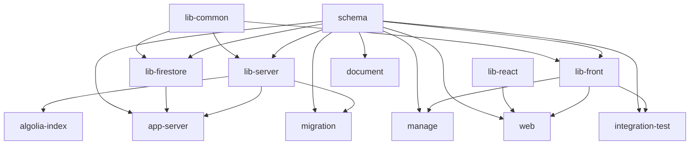

# backend_template

Firebase（Auth / Firestore / Storage / Hosting / Functions）をベースにした、バックエンドとフロントエンドのモノレポのテンプレートです。実運用しているバックエンドから、ドメインロジックを除いて構成だけを抜き出しています。サンプルのドメインは「ユーザー」と「投稿」です。

## 目次

1. [パッケージと依存関係](#packages)
2. [型の共有と、Firestore を直接読む方針](#type-sharing)
3. [機能を 1 つ足す手順（投稿の表示期間の例）](#add-feature)
4. [custom lint と knip](#lint)
5. [テスト](#testing)
6. [GitHub Actions と config](#ci-and-config)
7. [ローカルでの起動](#local-development)

<a id="packages"></a>
## 1. パッケージと依存関係

`schema` が中心です。API の型（OpenAPI から生成）、Firestore のドキュメント型（Zod）、`FirestorePaths`、エラーの定義を持ち、ほかのパッケージはすべて `schema` の型を使います。



| パッケージ | 内容 |
| --- | --- |
| [`schema`](./schema) | API（`api/*.yml` → `src/api/{app,manage,debug,private}` に型・SDK 関数・Request の Zod を生成）、Firestore のドキュメント（Zod）、`FirestorePaths`、`Errors`、SSR と SPA が共有するルート定義 |
| [`lib-common`](./lib-common) | サーバーとフロントエンドで共通のユーティリティ（`Try`、Tagged 型など） |
| [`lib-server`](./lib-server) | logger、リクエストコンテキスト、HTTP ロギング、Prometheus、Algolia、config のスキーマ（`Config`） |
| [`lib-firestore`](./lib-firestore) | サーバー側の Firestore のアクセス層（`PostAccess` など）と `waitFor` / `waitOpenFor` |
| [`lib-front`](./lib-front) | クライアントから Firestore を直接読む `FirestoreAccess` と hooks、`useZodForm` と `Managed*` フォーム |
| [`lib-react`](./lib-react) | SSR とブラウザの両方で使う React コンポーネント |
| [`app-server`](./app-server) | Express の API と、`api` / `job` / `daemon` / `daemon-all` の起動モード。Controller → UseCase → Access の層に分け、`Core` で DI する |
| [`firebase`](./firebase) | Firestore / Storage の rules と indexes、rules のテスト |
| [`web`](./web) | Vite + React の SPA と、`web/functions` の SSR（`renderHTML`） |
| [`manage`](./manage) | 管理画面（Vite + React） |
| [`document`](./document) | Firestore と API のドキュメント（Redoc）。Zod と OpenAPI から生成する |
| [`migration`](./migration) | Firestore のマイグレーション（依存関係つき） |
| [`algolia-index`](./algolia-index) | Algolia のインデックス設定の反映 |
| [`integration-test`](./integration-test) | エミュレータ上で app-server を起動して行う統合テスト |
| [`eslint`](./eslint) | 共通の ESLint 設定と custom rule |

<a id="type-sharing"></a>
## 2. 型の共有と、Firestore を直接読む方針

- **読み取りは GET API を作らず、クライアントが Firestore を直接読む**: web / manage は [`lib-front/src/firestore-access.ts`](./lib-front/src/firestore-access.ts) の `FirestoreAccess` と hooks（`useUser`、`usePosts`、`usePostsPage` など）で読みます。誰が何を読めるかは [`firebase/src/firestore.rules`](./firebase/src/firestore.rules) で決めます。API は書き込みと操作だけを持ちます
- **Firestore のドキュメント型**: [`schema/src/firestore`](./schema/src/firestore) に Zod で定義し（`PostDocumentBody`、`PostDocuments.fromDocumentSnapshot` など）、サーバーとクライアントの両方が同じ型と変換を使います。パスは [`schema/src/firestore-paths.ts`](./schema/src/firestore-paths.ts) の `FirestorePaths` に集めます
- **フィールド名は snake_case**: Firestore のドキュメントも API の Request / Response も、フィールド名は snake_case に統一しています。クライアントは Firestore から読んだ値と API に送る値を、名前を変換せずに扱えます
- **OpenAPI → 型とクライアント**: [`schema/api/*.yml`](./schema/api) から [Hey API](https://heyapi.dev/)（`@hey-api/openapi-ts`）で、API ごとに [`schema/src/api/{app,manage,debug,private}`](./schema/src/api) へ型と SDK 関数（fetch のクライアント込み）と Zod を生成します（`pnpm -C schema run build`、設定は [`schema/openapi-ts.config.ts`](./schema/openapi-ts.config.ts)）。Hey API は 1.0 より前で、minor でも破壊的変更が入るので、バージョンを固定しています
- **Controller のレスポンス型**: Controller は生成された operation のレスポンス型（`schema/api/app/types` の `CreatePostResponse` など）を直接指定します。manage / web / integration-test は同じ yml から生成した SDK 関数（`createPost({ client, body })` など）で呼ぶので、レスポンスの型がそのまま共有されます

  ```ts
  postApp.post("/posts", requireServiceLoginHandler<CreatePostResponse>(async (req, args) => { ... }))
  ```

- **Request の検証**: Controller は、yml から生成した Zod（`schema/api/app/zod` の `zCreatePostRequest` など）で body を検証します。Request の形は yml にしか書かないので、yml を変えると、検証も型も呼び出し側も一緒に変わります。ユーザーが自由に入力する string には、yml で独自の `format: user-free-input` を付けます。生成した Zod では、前後の空白を除いてから長さを検査します（`z.string().trim().min(1).max(32)`、変換は `schema/openapi-ts.config.ts` の resolver）

  ```yaml
  display_name:
    type: string
    format: user-free-input
    minLength: 1
    maxLength: 32
  ```

- **フォーム**: manage は [`lib-front/src/zod-form`](./lib-front/src/zod-form) の `useZodForm`（Zod スキーマ + react-hook-form）で、yml から生成した Request の Zod（`zManageUpdateUserRequest` など）からフォームを組みます
- **エラー**: [`schema/src/api/error.ts`](./schema/src/api/error.ts) の `Errors`（UPPER_SNAKE の kind、HTTP ステータス、Zod の `details`）から、API のエラーのドキュメントを生成します

<a id="add-feature"></a>
## 3. 機能を 1 つ足す手順（投稿の表示期間の例）

投稿の表示期間（開始と終了の時刻を持ち、期間内だけほかのユーザーに見える投稿）を例に、どのファイルをどの順に変えるかを示します。期間は元の popopo_backend の Period / PeriodState のパターンで持ちます。

rules の `request.time` で期間を判定せず、daemon が `display_period_state.active` を書き換えるのは、エミュレータで次のことを確かめたからです。クライアントは `display_period_state.active == true` の等値条件で読みます。

- list は、クエリに入れた時刻が `request.time` より後だと拒否される。そのため、クライアントの時計が進んでいると一覧ごと拒否される
- onSnapshot で購読している間に公開時刻を過ぎても、その投稿は結果に現れない。クエリの時刻が購読時の値のままだから
- 終了時刻のある期間を rules で判定するには、クエリの側に前後の余裕を持たせる必要があり、終了の前に見えなくなる

1. **schema**
   - [`schema/src/firestore/common.ts`](./schema/src/firestore/common.ts): `Period`（yml の `Period` から生成した Zod。`start_at` / `end_at`、`end_at` が null なら無期限）、`PeriodState`（`active` / `next_change_at`）、`calculatePeriodState`
   - [`schema/src/firestore/post.ts`](./schema/src/firestore/post.ts): `PostDocumentBody` に `display_period` と `display_period_state` を足す
   - [`schema/api/app_api.yml`](./schema/api/app_api.yml) と [`schema/api/manage_api.yml`](./schema/api/manage_api.yml): `CreatePostRequest` と `ManageUpdatePostRequest` の `display_period` と、`PUT /api/v1/manage/posts/{post_id}` を足し、`pnpm -C schema run build` で型・SDK 関数・Zod を再生成する
2. **Controller / UseCase / Access**
   - [`app-server/src/app/api/controllers/post-controller.ts`](./app-server/src/app/api/controllers/post-controller.ts) と [`manage-post-controller.ts`](./app-server/src/app/api/controllers/manage/manage-post-controller.ts): リクエストを生成した Zod で検証して UseCase を呼ぶ（manage は `EditPost` の権限で守る）
   - [`app-server/src/usecase/post-use-case.ts`](./app-server/src/usecase/post-use-case.ts): 作成・変更時に `calculatePeriodState` で初期の state を計算し、`updateDisplayPeriodStatus` で state を更新する
   - [`lib-firestore/src/access/post-access.ts`](./lib-firestore/src/access/post-access.ts): `waitOpenFor` で `display_period_state.next_change_at` を待つ `waitPostDisplayPeriodChange` と、`display_period_state` だけを `tx.update` する `updateDisplayPeriodStatus`
3. **rules と indexes**
   - [`firebase/src/firestore.rules`](./firebase/src/firestore.rules): `display_period_state.active == true` の投稿だけをほかのユーザーが読める（期間外は投稿者だけ）
   - [`firebase/src/firestore.indexes.json`](./firebase/src/firestore.indexes.json): `posts(display_period_state.active, created_at desc)` と `posts(user_id, display_period_state.active, created_at desc)`
   - [`firebase/tests/firestore-rules.test.ts`](./firebase/tests/firestore-rules.test.ts): rules のテスト
   - [`lib-front/src/firestore-access.ts`](./lib-front/src/firestore-access.ts): `usePosts` と `usePublicPostsByUser` を `display_period_state.active == true` に絞る（rules で読めるものだけを問い合わせる）。期間外も含む `useAllPostsByUser` は、投稿者本人と manage 用
   - [`manage/src/component/form/PostDisplayPeriodForm.tsx`](./manage/src/component/form/PostDisplayPeriodForm.tsx): `useZodForm` と `ManagedDateTimeRangeInput` で開始・終了（無期限も可）を入力する
4. **daemon**
   - [`app-server/src/app/daemon/controllers/update-post-display-period.ts`](./app-server/src/app/daemon/controllers/update-post-display-period.ts): `defineWaitAndProcessDaemon`（[`WaitAndProcessRunner`](./app-server/src/app/daemon/lib/WaitAndProcessRunner.ts)）で、開始と終了の時刻を待って state を書き換える
   - [`app-server/src/app/daemon/main.ts`](./app-server/src/app/daemon/main.ts): `daemonDefinitions` に登録する（`check` で、controllers との一致を確認している）
   - タスクを積んで処理する場合は、`TaskConsumer`（[`consume-sync-user-to-algolia-task.ts`](./app-server/src/app/daemon/controllers/consume-sync-user-to-algolia-task.ts)）を使う
5. **統合テスト**
   - [`integration-test/src/test/daemon/update-post-display-period-test.ts`](./integration-test/src/test/daemon/update-post-display-period-test.ts): API で期間付きの投稿を作り、[`daemon-runner`](./integration-test/src/util/test-helpers/daemon-runner.ts) で daemon を起動して、開始で active、終了で inactive になるのを確かめる
6. **ドキュメント**: 新しいコレクションを足したときは [`document/src/documents.ts`](./document/src/documents.ts) に登録する（登録漏れは lint で検出される）

<a id="lint"></a>
## 4. custom lint と knip

| ルール | 使っているパッケージ | 防ぐもの |
| --- | --- | --- |
| `custom/firestore-index-check` | app-server、integration-test、lib-front | 複合インデックスが必要なクエリで、`firestore.indexes.json` への追加漏れ |
| `custom/no-direct-admin-firestore` | integration-test | テストで Admin SDK の Firestore を直接使うこと（`FirebaseAdminUser` を使う） |
| `custom/no-bracket-identifier-literal` | integration-test | `obj["name"]` の形で private / protected を回避すること |
| `custom/no-usecase-to-usecase` | app-server | UseCase から UseCase（Service から UseCase）を呼ぶこと |
| `custom/no-service-in-core` | app-server | Service を `Core` に DI のシングルトンとして登録すること |
| `custom/no-internal-import` | app-server | `internal/` ディレクトリを親の外から import すること |
| `custom/firestore-kebab-case` | schema | コレクション名が kebab-case でないこと |
| `custom/firestore-snake-case` | schema | Firestore のドキュメントのフィールド名が snake_case でないこと（API のフィールド名は yml が正） |
| `custom/check-firestore-paths-coverage` | document | `FirestorePaths` のパスの `documents.ts` への登録漏れ |
| `custom/firestore-indexes-structure` | firebase | `firestore.indexes.json` の構造の誤り |
| `comparison-operators/no-greater-than-operators` | 全パッケージ | `>` / `>=` の比較（`<` / `<=` に揃えて読みやすくする） |
| `react-hook-form/no-formstate-in-jsx` | 全パッケージ（React の設定でも有効） | JSX の属性で `formState` を直接参照すること（再レンダリングの漏れ） |

ルールの実装は [`eslint`](./eslint) と、各パッケージの `eslint-rules` にあります。`@typescript-eslint/no-unused-vars` はすべての設定で error です。

[knip](https://knip.dev/) で、使われていない export・ファイル・依存を検出します（`pnpm run knip`、CI の `knip` ジョブ）。動的に読み込むファイル（Vite の alias で読む `env/*/config.ts`、migrations など）は [`knip.json`](./knip.json) で entry に指定しています。

<a id="testing"></a>
## 5. テスト

| 種類 | 場所 | 実行 |
| --- | --- | --- |
| 単体テスト | 各パッケージの `test/`（例: [`app-server/test`](./app-server/test)。UseCase は `MockFirestoreAccess` で fake のトランザクションを即時実行する） | `pnpm run test` |
| rules のテスト | [`firebase/tests`](./firebase/tests)（`@firebase/rules-unit-testing` で Firestore / Storage の rules を確かめる） | `pnpm run test`（エミュレータを使う） |
| 統合テスト | [`integration-test/src/test`](./integration-test/src/test) | `pnpm run test:integration` |

- 統合テストは、エミュレータ（Firestore / Auth / Storage）と app-server を起動して、生成した SDK 関数で API を呼び、クライアント SDK で Firestore を直接読んで確かめます（`AppUser` / `ManageUser` / `FirebaseAdminUser`）
- `testWithEnvironment` / `testOnlyEmulator` で、テストを実行する環境を絞ります（daemon を起動するテストや、データを書き換えるテストはエミュレータだけ）
- daemon の処理は、テストの中で [`daemon-runner`](./integration-test/src/util/test-helpers/daemon-runner.ts) が daemon を起動し、条件を満たすまで待って確かめます。Algolia はエミュレータがないので、fake server に向けます
- [`firebase/tests/bigquery-exports.test.ts`](./firebase/tests/bigquery-exports.test.ts) は、`FirestorePaths` のコレクションごとに BigQuery Export Extension の設定（`firebase/extensions/*.env`）があるかと、instance ID が 46 文字未満かを確かめます。export しないコレクションは、テストの中の除外リストに理由つきで書きます
- PR の CI では、`check-and-test.yml` から [`integration-test-local-emulator.yml`](./.github/workflows/integration-test-local-emulator.yml) を呼び、8 shard で実行します

<a id="ci-and-config"></a>
## 6. GitHub Actions と config

### ブランチと環境

ブランチと環境が 1 対 1 に対応します。リリースは `beta` → `dev` → `stage` → `prod` の順に PR でマージします（[`pr-base-branch-guard.yml`](./.github/workflows/pr-base-branch-guard.yml) がそれ以外のマージ先に警告します）。

| ブランチ / 環境 | 用途 |
| --- | --- |
| `beta` | バックエンドの開発（機能ブランチの PR のマージ先。`/betaloy` で PR のブランチを試せる） |
| `dev` | クライアント（アプリ）との結合確認 |
| `stage` | デモ・リリース前の確認 |
| `prod` | 本番 |

### 変更検知つきのデプロイと `/betaloy`

ブランチへの push で [`deploy-on-push.yml`](./.github/workflows/deploy-on-push.yml) → [`deploy-all.yml`](./.github/workflows/deploy-all.yml) が動きます。[`detect-deploy-targets`](./.github/actions/detect-deploy-targets/action.yml) が `dorny/paths-filter` で変更のあったパッケージ（と依存先）を調べ、それだけをデプロイします。PR に `/betaloy` とコメントすると（[`deploy-on-pr-comment.yml`](./.github/workflows/deploy-on-pr-comment.yml)）、その PR のブランチを beta 環境にデプロイできます。

| 対象 | デプロイ先 |
| --- | --- |
| `firebase` | Firestore / Storage の rules と indexes（インデックス作成の完了まで待つ） |
| `app-server` | Cloud Functions（`api`: Express を `onRequest` で包む、`reindexAlgolia`: `onSchedule`）と、daemon ごとの Cloud Run worker pool（インスタンスが動いている間ずっと課金される。[infra/deploy/README.md](./infra/deploy/README.md#daemon-は-cloud-run-worker-pools-で動かす)） |
| `web` | Firebase Hosting + Functions（`renderHTML`） |
| `manage` / `document` | Firebase Hosting |
| `migration` / `algolia-index` | GitHub Actions のランナー上で実行 |

GCP へは OIDC（Workload Identity Federation）でログインします（[`gcp-login`](./.github/actions/gcp-login/action.yml)）。`your-project-*` や `example.com` などのプレースホルダーは、自分の環境の値に置き換えてください。

### SHA pin と permissions

- 外部の action は、workflow と composite action のどちらでも、full commit SHA で pin し、`# vX.Y.Z` のコメントを付けています（例: `uses: actions/checkout@<40 桁の SHA> # v7.0.1`）。SHA はその action の公式リポジトリのタグから取ります
- `check-and-test.yml` の `actions-pinned` ジョブ（[`check-actions-pinned.mjs`](./.github/scripts/check-actions-pinned.mjs)）が、すべての `uses:` が SHA で pin され、バージョンのコメントが付いているかを確認します
- テンプレートでは Dependabot を設定していません。action を更新するときは、SHA と `# vX.Y.Z` のコメントを一緒に書き換えます
- 各 workflow の `permissions` は既定で `contents: read` にし、OIDC のジョブだけ `id-token: write` を付けています。checkout は `persist-credentials: false` で、`run:` には `${{ }}` を直接書かず `env:` を通します

リポジトリや Organization の設定（Settings → Actions → General）で、次の policy も使えます。テンプレートでは有効にしていません。

- **Require actions to be pinned to a full-length commit SHA**: SHA で pin していない action を実行させない
- **Allow / block actions**: 使ってよい action を絞る、または特定の action をブロックする
- **Require lockfile**（[workflow lockfile](https://docs.github.com/en/actions/how-tos/secure-your-work/lock-workflow-dependencies)）: まだ public preview なので使っていない

### config と sops

- 設定は環境ごとに 1 ファイル（`infra/conf/{env}.config.encrypted.json`）です。スキーマは [`lib-server/src/config/config.ts`](./lib-server/src/config/config.ts) の `Config` だけで、各サービスは `Config.pick({...})` で必要な部分を Zod で検証します。ローカルでは各パッケージの `conf/local.json` を読みます
- キー名が `!` で終わる値（例: `"apiKey!"`）だけを [SOPS](https://github.com/getsops/sops) + age で暗号化します（[`.sops.yaml`](./.sops.yaml) の `encrypted_regex: "!$"`）。ほかの値は平文のままなので、差分をレビューできます。書き方の例は [`infra/conf/example.config.json`](./infra/conf/example.config.json) です
- app-server は、復号した設定を Secret Manager に置いて `defineSecret` で読みます（Functions のソースアーカイブに平文を入れない）
- 鍵の作り方と、暗号化・編集の手順は [infra/README.md](./infra/README.md) にあります

### 依存のバージョン

主要な依存は最新の安定版にしています。次のものは、ツールチェーンが対応していないので据え置いています。

| パッケージ | 据え置き | 最新 | 理由 |
| --- | --- | --- | --- |
| `typescript` | 6.0 | 7.0（native 版） | `typescript-eslint` の peer が `<6.1.0`、`ts-jest` の peer が `<7`のため |
| `eslint` / `@eslint/js` | 9 | 10 | `eslint-plugin-react` の peer が ESLint 9 までのため |
| `@types/node` | 24 | 26 | Node 本体を Cloud Functions（2nd gen）の GA のランタイム（Node.js 24）に合わせているため。Node.js 26 は [Preview](https://cloud.google.com/functions/docs/runtime-support) です。 |

<a id="local-development"></a>
## 7. ローカルでの起動

必要なもの:

- Node.js 24.22.1（`.nvmrc`）
- pnpm 12（`corepack enable` で `packageManager` のバージョンが使われます）
- Java 21 以上（Firebase Emulator 用）

```bash
pnpm install
pnpm run build

# エミュレータ（Firestore / Auth / Storage）、API サーバー（http://localhost:3000）、管理画面（http://localhost:5174）をまとめて起動する
pnpm run dev

# 別のターミナルで、ローカル用の管理者（admin@example.com / password）とサンプルの投稿をマイグレーションで作る
pnpm -C migration run apply:emulator

# daemon（Algolia への同期、投稿の表示期間の更新）をすべて起動する
pnpm -C app-server run daemon:dev:all

# Web（SPA + SSR）を Hosting と Functions のエミュレータで起動する（http://127.0.0.1:5002。/posts/{postId} は SSR）
pnpm -C web run dev

# ドキュメント
pnpm -C document run serve
```

チェック:

```bash
pnpm run check             # 型チェック
pnpm run lint              # lint（custom rule を含む）
pnpm run knip              # 使われていない export・ファイル・依存
pnpm run test              # 単体テストと rules のテスト
pnpm run test:integration  # エミュレータ上で app-server を起動して統合テスト
```

## ライセンス

[Apache License 2.0](./LICENSE)
